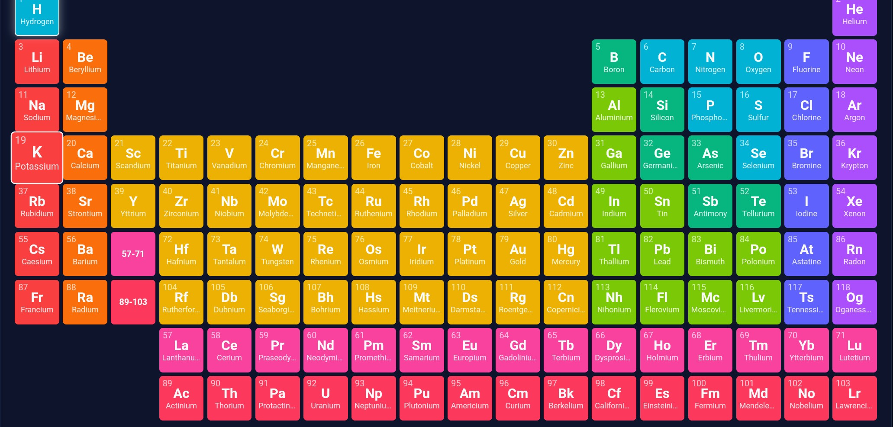

# ⚛️ Interactive Periodic Table Explorer

An interactive, responsive 118-element periodic table web application featuring dynamic property heatmaps, real-time orbital Bohr diagrams, and retro arcade chiptune sound effects.

🚀 **Live Demo:** [https://funhouseme.github.io/periodic-table/](https://funhouseme.github.io/periodic-table/)

---

## 📸 Preview



---

## ✨ Features

- **Full 118 Chemical Elements:** Complete dataset containing atomic weights, categories, electron configurations, and periodic groupings.
- **Dynamic Property Heatmaps:** Instantly visualize gradients across the periodic grid for:
  - Electronegativity
  - Atomic Radius
  - Ionization Energy
- **Live Bohr Orbital Visualizer:** Real-time canvas rendering of electron shell populations for any selected element.
- **8-Bit Arcade Synthesizer:**
  - Built with the native browser **Web Audio API** (no external audio assets).
  - Emulates vintage 8-bit LFSR (Linear-Feedback Shift Register) pseudo-noise channels.
  - **Atomic Number ($Z$) Pitch-Scaling:** Light elements produce high-frequency arcade laser pops; heavy elements trigger low-frequency cabinet detonations.
  - Interactive header mute/unmute toggle (`🔊 SFX: ON` / `🔇 SFX: OFF`).
- **Retro Particle Physics:** 8-bit rotating pixel shard fragmentation with expanding octagonal shockwaves on cell activation.
- **Rich Social Previews:** Fully configured Open Graph and Twitter card metadata with vector favicon support.

---

## 🛠️ Built With

- **HTML5** & **Semantic Grid CSS** (fully responsive, desktop & mobile optimized)
- **Vanilla JavaScript** (zero external dependencies or frameworks)
- **Web Audio API** (real-time chiptune sound synthesis)
- **HTML5 2D Canvas** (particle explosion physics & Bohr orbital diagrams)
- **GitHub Pages** (continuous deployment)

---

## 🚀 Local Setup

To run or modify the project locally:

1. Clone the repository:
   ```bash
   git clone [https://github.com/FUNHOUSEme/periodic-table.git](https://github.com/FUNHOUSEme/periodic-table.git)
